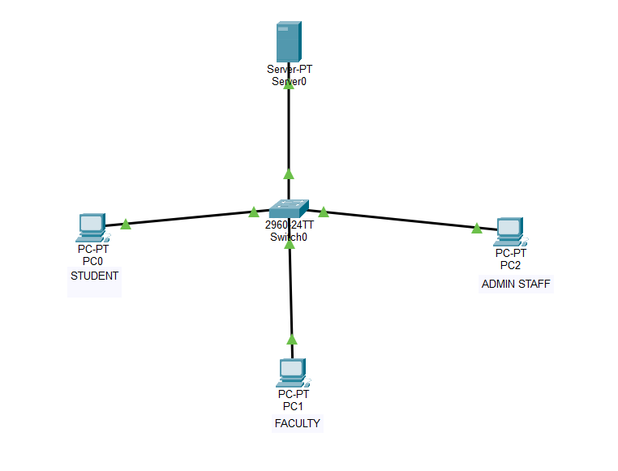
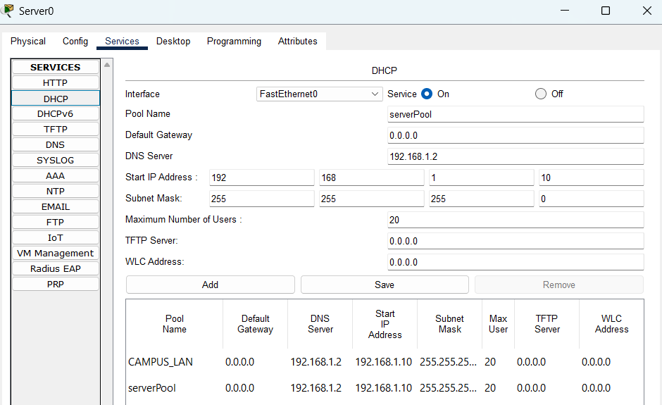
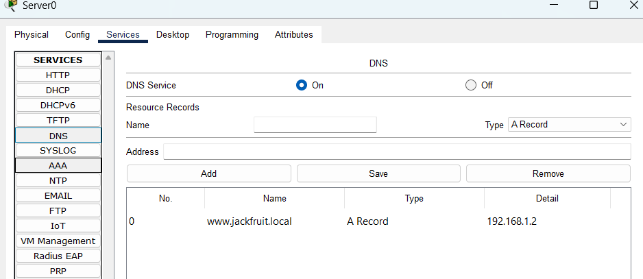
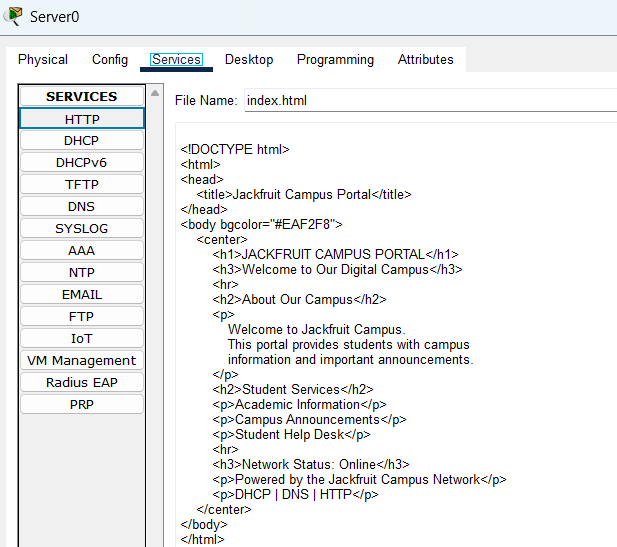
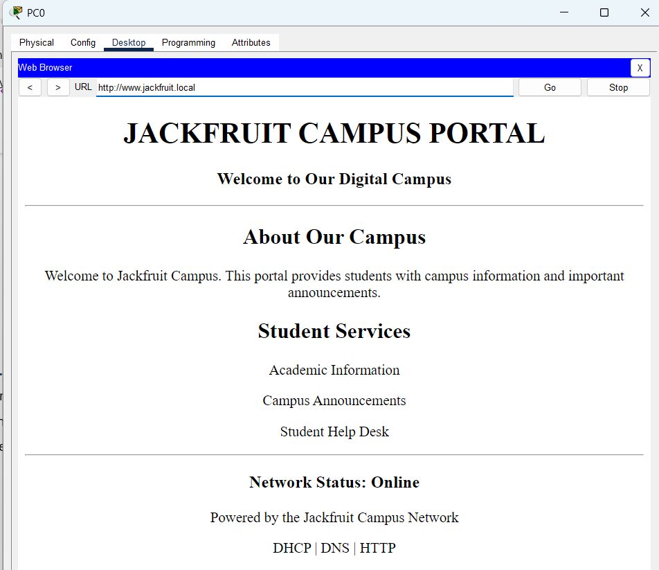
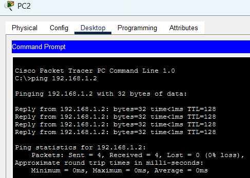

# Jackfruit Campus Network

A small campus LAN built and tested in **Cisco Packet Tracer** for a Computer Communication Networks (CCN)nproject.

The network connects three client PCs and one server through an Ethernet switch. The server provides DHCP, DNS and HTTP services, allowing clients to receive their network settings automatically and open a campus webpage using a local domain name.

## Project overview

- **Network type:** Single LAN
- **Simulation tool:** Cisco Packet Tracer
- **Clients:** PC0, PC1 and PC2
- **Network device:** Switch0
- **Server:** Server0
- **Services:** DHCP, DNS and HTTP

## Network topology



Each PC and Server0 is connected to Switch0. Since the devices are in the same subnet, a router is not required for the communication demonstrated in this project.

## Addressing

| Item | Configuration |
|---|---|
| Network address | `192.168.1.0/24` |
| Subnet mask | `255.255.255.0` |
| Server0 | `192.168.1.2` (static) |
| DHCP starting address | `192.168.1.10` |
| DNS server | `192.168.1.2` |
| Local domain name | `www.jackfruit.local` |

Client PCs are configured to obtain their IPv4 settings through DHCP.

## Services configured

### DHCP

DHCP is enabled on Server0. The `CAMPUS_LAN` pool is configured with a starting address of `192.168.1.10`, subnet mask `255.255.255.0`, and DNS server `192.168.1.2`.



### DNS

DNS is enabled on Server0 with an A record that maps:

`www.jackfruit.local` → `192.168.1.2`



### HTTP

HTTP is enabled on Server0. The server hosts a custom `index.html` page for the Jackfruit Campus Portal.



The portal can be opened from a client PC using either address:

- `http://192.168.1.2`
- `http://www.jackfruit.local`



## Testing

The project uses client-side commands and browser checks to verify the network.

| Test | Command / action | Expected result |
|---|---|---|
| View IP configuration | `ipconfig` | Displays the client's current IP settings |
| View detailed settings | `ipconfig /all` | Displays detailed configuration where supported |
| Renew DHCP lease | `ipconfig /renew` | Requests a lease renewal where supported |
| Test server reachability | `ping 192.168.1.2` | Replies from Server0 |
| Test name resolution and reachability | `ping www.jackfruit.local` | Resolves and reaches the server where supported |
| Test HTTP by IP | Open `http://192.168.1.2` | Campus portal loads |
| Test DNS and HTTP | Open `http://www.jackfruit.local` | Same portal loads using the local name |

A successful ping to Server0 is shown below.



## Repository contents

```text
Jackfruit-Campus-Network/
├── README.md
├── docs/
│   ├── network_topology.png
│   ├── server_ipconfig_all.png
│   ├── server_static_ip_configuration.png
│   ├── dhcp_server_configuration.png
│   ├── client_dhcp_ip_configuration.png
│   ├── dns_a_record_configuration.png
│   ├── http_index_html_configuration.png
│   ├── jackfruit_campus_portal.png
│   └── server_ping_connectivity_test.png
├── Packet_Tracer/
│   └── Jackfruit_Campus_Network.pkt
├── Documentation/
└── Presentation/
```


## Notes

- `www.jackfruit.local` is a name configured for this simulated LAN; it is not a public Internet domain.
- The project demonstrates communication within one subnet. It does not implement VLANs, routing between networks or Internet access.
- Packet Tracer PCs use a simplified command prompt, so command support may vary.

## Project team

- **Pranav Shashikumar** 
- **Parikshith A** 

## References

- Cisco Networking Academy — Cisco Packet Tracer learning and simulation materials.
- [Cisco Packet Tracer](https://www.netacad.com/cisco-packet-tracer)
- *Computer Networking: A Top-Down Approach* — James F. Kurose and Keith W. Ross.
